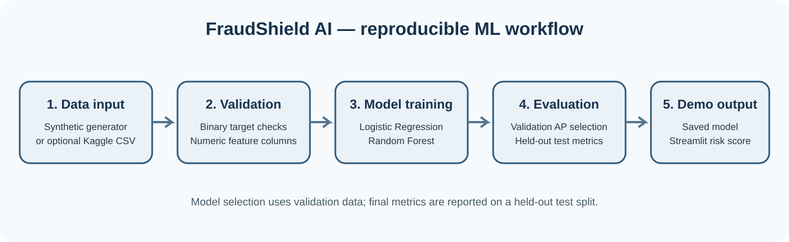
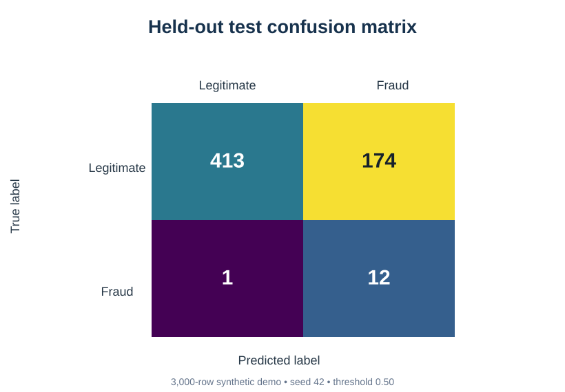

# FraudShield AI

**An end-to-end, reproducible machine-learning project for credit-card transaction fraud detection.**

[](https://github.com/strawhat0605/fraudshield-ai/actions/workflows/ci.yml)


FraudShield AI demonstrates how to build and evaluate classification models when fraud is a rare positive class. It includes data validation, reproducible synthetic data generation, model comparison, held-out evaluation, saved artifacts, a Streamlit scoring demo, automated tests, and CI.

> **Research and safety note:** This is an educational portfolio project, not a production fraud-detection system. The included dataset is synthetic. Its scores are useful only for demonstrating the pipeline and do not establish performance on real transactions. Never enter real customer/payment information or use these predictions to make financial decisions.

## Project workflow



1. Generate a reproducible imbalanced demo dataset or provide the optional public Kaggle CSV.
2. Validate the binary target and numeric feature columns.
3. Train Logistic Regression and Random Forest baseline pipelines.
4. Select the candidate with the best validation average precision.
5. Refit the selected model on training plus validation data and evaluate once on a held-out test split.
6. Save the model and metrics, then use the Streamlit interface to demonstrate transaction scoring.

## Visual results

The following confusion matrix is from the included **3,000-row synthetic demonstration run** (seed 42). It is not a real-world benchmark.



| Metric | Synthetic demo result |
|---|---:|
| Average precision (AP) | 0.6045 |
| ROC-AUC | 0.9303 |
| Precision at threshold 0.50 | 0.0645 |
| Recall at threshold 0.50 | 0.9231 |
| F1 at threshold 0.50 | 0.1206 |

The high recall and low precision illustrate the trade-off at the default threshold: many legitimate transactions are also flagged. Threshold tuning should be based on validated business costs in a real application. These synthetic results must not be compared directly with published banking benchmarks.

## Quick start

Python 3.10–3.12 is recommended.

```bash
# 1. Clone the repository
git clone https://github.com/strawhat0605/fraudshield-ai.git
cd fraudshield-ai

# 2. Create and activate a virtual environment
python -m venv .venv

# macOS / Linux
source .venv/bin/activate

# Windows PowerShell
# .venv\Scripts\Activate.ps1

# 3. Install the project and dependencies
python -m pip install --upgrade pip
pip install -e .
pip install -r requirements.txt
pip install -r requirements-dev.txt

# 4. Generate synthetic demo data
python scripts/generate_demo_data.py --rows 12000

# 5. Train and evaluate the models
python -m fraudshield.train --data data/processed/demo_transactions.csv

# 6. Launch the interactive dashboard
streamlit run app.py
```

Open the local URL printed by Streamlit. The dashboard requires a trained model in `artifacts/`; run the training command before launching it. The dashboard accepts feature values and displays an estimated fraud probability with the configured decision threshold.

## Optional: use the public Kaggle dataset

The widely used [Credit Card Fraud Detection dataset](https://www.kaggle.com/datasets/mlg-ulb/creditcardfraud) contains anonymized transaction features and a binary `Class` target.

1. Download the dataset from Kaggle and review its terms of use.
2. Place `creditcard.csv` at `data/raw/creditcard.csv`.
3. Run:

```bash
python -m fraudshield.train --data data/raw/creditcard.csv
```

The expected target is `Class` (`0` = legitimate, `1` = fraud). Numeric columns other than `Class` are used as features. The downloaded dataset is intentionally excluded from version control; do not upload it unless its license permits redistribution.

## Evaluation methodology

Fraud datasets are usually highly imbalanced, so accuracy alone can hide poor fraud detection. FraudShield reports:

- **Average precision (AP / PR-AUC):** summarizes the precision-recall curve and is informative when the positive class is rare.
- **Precision:** the fraction of flagged transactions that are fraud.
- **Recall:** the fraction of actual fraud cases detected.
- **F1-score:** the harmonic mean of precision and recall at the selected threshold.
- **ROC-AUC:** ranking quality across false-positive rates.
- **Confusion matrix:** true/false positives and negatives.

The validation split selects the model using average precision. The test split is kept separate until final evaluation. The default threshold is 0.50 for demonstration; it is not claimed to be optimal.

## Run tests

```bash
pip install -r requirements-dev.txt
pytest -q
```

The GitHub Actions workflow runs the test suite and Python compilation checks on Python 3.10, 3.11, and 3.12.

## Repository structure

```text
fraudshield-ai/
├── app.py                         # Streamlit demo interface
├── src/fraudshield/
│   ├── data.py                    # CSV loading and validation
│   ├── modeling.py                # Model pipelines and metrics
│   └── train.py                   # Split, selection, evaluation, persistence
├── scripts/generate_demo_data.py  # Reproducible synthetic data
├── tests/                         # Unit tests
├── docs/images/                   # README workflow and result visuals
├── reports/EXPERIMENTS.md         # Experiment notes and reporting template
├── .github/workflows/ci.yml       # Automated checks
├── pyproject.toml                 # Installable Python package configuration
├── requirements*.txt
└── LICENSE
```

## Limitations and next steps

- Synthetic data is for pipeline demonstration only; it cannot establish real fraud-detection performance.
- Kaggle's `V1`–`V28` features are anonymized, which limits interpretation.
- The current evaluation uses a random stratified split; time-based validation would better reflect some deployment settings.
- Threshold selection, cost-sensitive evaluation, calibration, drift monitoring, fairness, privacy, and production security need further work.

Planned improvements:

- [ ] Repeated stratified cross-validation and confidence intervals.
- [ ] Cost-sensitive threshold selection and precision-recall operating-point analysis.
- [ ] SHAP explanations and explanation stability checks.
- [ ] Time-based validation and drift monitoring.
- [ ] Experiment tracking and model-card documentation.

## License

Released under the [MIT License](LICENSE).

## Maintainer

[strawhat0605](https://github.com/strawhat0605)
